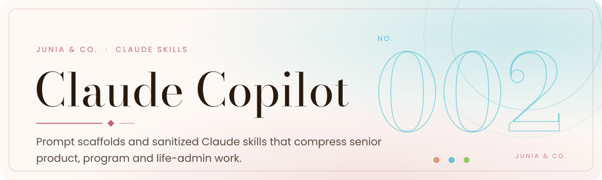

<picture>
  <source media="(prefers-color-scheme: dark)" srcset=".github/brand/banner-dark.svg">
  
</picture>

 

A working collection of reusable prompts, skill files, and small utilities that compress senior product and program workflows. Built and tested against real platform work at scale (16M+ accounts, 30M+ account migrations) by a Senior Data/AI/Risk Product Manager, then extended to the rest of a busy operator's week: inbox, network, content, and planning.

## What's here

### Program workflow modules

| Module | Purpose |
|---|---|
| [/prompts/prd-skeleton](prompts/prd-skeleton.md) | Structured PRD generation from a one-line problem statement |
| [/prompts/migration-runbook](prompts/migration-runbook.md) | Pre-flight, cut-over, and rollback runbooks for data migrations |
| [/prompts/exec-summary](prompts/exec-summary.md) | One-pager for senior leadership readouts |
| [/skills/standup-synthesizer](skills/standup-synthesizer/SKILL.md) | Reads raw standup notes and produces a leadership-grade async update |
| [/skills/risk-register](skills/risk-register/SKILL.md) | Maintains a living risk register from PR comments, Slack threads, and meeting notes |

### Personal operating system skills

Sanitized templates of skills used daily. Personal specifics are replaced with `{{PLACEHOLDER}}` variables, documented at the top of each file.

| Skill | Purpose |
|---|---|
| [priority-check](skills/priority-check/SKILL.md) | Gates any new project against yearly priorities and weekly capacity with a Go, Fold in, or Park call |
| [life-tracker-update](skills/life-tracker-update/SKILL.md) | Reads and writes a single-source-of-truth task tracker in Google Sheets, with strict row and status rules |
| [life-audit](skills/life-audit/SKILL.md) | Quarterly all-tracks audit with an evidence-based scorecard, letter grades, and dated actions |
| [career-writing-standards](skills/career-writing-standards/SKILL.md) | Style rules plus a verified fact sheet for resumes, bios, and outreach, with a pre-delivery check |
| [inbox-triage](skills/inbox-triage/SKILL.md) | Sorts inboxes into [DELETE], [REVIEW], and [REPLY] labels without ever deleting or sending |
| [network-playbooks](skills/network-playbooks/SKILL.md) | Event prep, negotiation scripts, and reconnect messages, logged to a tiered contact tracker |
| [newsletter-draft](skills/newsletter-draft/SKILL.md) | Drafts a local community newsletter in a fixed 12-section, gamified format |
| [newsletter-html-build](skills/newsletter-html-build/SKILL.md) | Builds paste-ready, accessible Mailchimp HTML from a master design, plus a browser fact-check prompt |
| [realtor-outreach-campaign](skills/realtor-outreach-campaign/SKILL.md) | FSBO, FRBO, or farming campaign: templated postcards, a 30-day cadence, and a compliance checklist |
| [footage-ingest](skills/footage-ingest/SKILL.md) | Collects multi-device shoot footage, syncs external mic audio, matches takes to scripts, and indexes keepers |
| [video-review](skills/video-review/SKILL.md) | Frame-by-frame video QA with timestamped producer notes and a Post, Fix, or Reshoot verdict |

## How to use a skill with Claude

A skill is a folder containing a `SKILL.md` file. The YAML front matter (`name`, `description`) tells Claude when to load it; the body tells Claude how to do the work.

1. Copy a folder from `/skills` (for example `skills/risk-register/`).
2. Replace every `{{PLACEHOLDER}}` using the table at the top of the file. Delete sections that do not apply.
3. Install it:
   - **Claude Code:** place the folder in `~/.claude/skills/` (personal) or `.claude/skills/` inside a project (shared with the repo).
   - **claude.ai:** zip the folder and upload it under Settings, Capabilities, Skills.
4. Trigger it in plain language ("audit me", "triage my inbox", "synthesize standup"). Claude loads the skill when the request matches its description.

Prompts in `/prompts` need no install: paste the prompt block into Claude and fill the variables.

## Why this exists

Senior product and program work is mostly compression. Turning unstructured input (Slack, calls, Jira, design docs) into structured output (PRDs, decisions, runbooks, exec briefs) under time pressure. These tools systematize that compression, at work and outside it.

## Design principles

1. **No fluff** (output reads like a senior practitioner wrote it)
2. **Stakeholder-aware** (every prompt asks who the audience is before drafting)
3. **Defensible** (explicit assumptions, risks, and unknowns surfaced, never hidden)
4. **Auditable** (every output includes a "what was assumed" footer)
5. **Safe by default** (skills label, draft, and propose; a human sends, deletes, and approves)

## Status

In active development. Public for transparency. No proprietary information from any employer included, and no personal data: every skill ships as a template.

  

